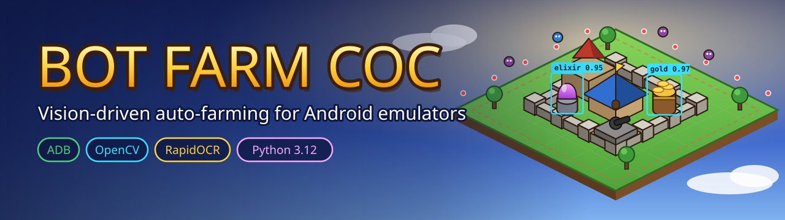

<p align="center">
  
</p>

<p align="center">
  
  
  
  
  
</p>

<p align="center">
  A screen-reading farming bot for Clash of Clans running in an Android emulator.<br>
  It sees the game through ADB screenshots, reads loot with OCR, and plays the attack loop on its own —
  no memory reading, no packet tampering, no modified game files.
</p>

---

> [!WARNING]
> **Use at your own risk.** Automating gameplay violates Supercell's
> [Terms of Service](https://supercell.com/en/terms-of-service/), and Supercell runs regular ban waves
> that **permanently** ban bot accounts. Test on a spare account, never on your main one.
> This project is for learning and is not affiliated with, endorsed by, or sponsored by Supercell.

## Table of contents

- [Features](#features)
- [How it works](#how-it-works)
- [Requirements](#requirements)
- [Installation](#installation)
- [Calibration](#calibration)
- [Configuration](#configuration)
- [Dashboard](#dashboard)
- [Usage](#usage)
- [Logs and statistics](#logs-and-statistics)
- [Project structure](#project-structure)
- [Development](#development)
- [Troubleshooting](#troubleshooting)

## Features

- **Terminal dashboard** — `python -m coc_bot` opens an interactive TUI: system info at a glance,
  start / pause / stop with a live log, calibration checklist, settings editor, statistics and a vision test.
- **Fast win farming** — attacks, waits until **50 % destruction** (one star = win and league bonus),
  then surrenders early to start the next battle. Built for the *Clash Anytime* era with no training time.
- **Loot filter** — reads the enemy's available Gold / Elixir / Dark Elixir with OCR and skips bases below
  your thresholds, with a cap on how many times it presses *Next*.
- **Configurable deployment** — troops along calibrated "clock" lines or the map diamond (`v_top`,
  `v_bottom`, `all`), plus siege machine and heroes with automatic ability activation.
- **Spells** — drops spells such as Rage in rows like the troops, shifted forward in front of them,
  a few seconds after they land, to push them past 50 % faster.
- **Storage-full check** — measures your Gold / Elixir / Dark Elixir bars before each attack and stops
  (or waits) when they are full, so no loot goes to waste. No storage capacity to configure.
- **Self-recovery** — detects popups, stuck screens and lost connections; escalates from *Back* to a full
  game restart, with a no-progress watchdog so a long unattended run never hangs silently.
- **Human-like timing** — random tap jitter and delays, optional play/break sessions with daily hour caps.
- **Background-friendly** — all input and capture go through ADB, the emulator window does not need focus.
- **Easy calibration** — mark buttons, text regions and points on a live screenshot; recalibrate after a
  game update instead of retraining a model.

## How it works

```text
             ┌──────────────── ADB (screencap / input tap) ────────────────┐
             │                                                             │
  LDPlayer ──┤   screenshot ──► detect screen ──► state handler ──► taps   ├── LDPlayer
             │                  (OpenCV templates)   │                     │
             └───────────────────────────────────────┼─────────────────────┘
                                                     ▼
                                         RapidOCR: loot, storage, damage %
```

Every tick the bot takes a screenshot, identifies the current screen and runs the handler for it:

```text
HOME ─► ATTACK_MENU ─► SEARCHING ─► BASE_PREVIEW ─┬─(loot too low)─► Next ─┐
  ▲                                               │                        │
  │                                               └─(loot ok)─► BATTLE ◄───┘
  │                                                                │ 50 % / stalled / timeout
  └───────────────────────── RESULT ◄──────── surrender ◄──────────┘
```

Popups are dismissed whenever they appear. If the screen stops moving forward, the bot presses *Back*,
then restarts the game, and finally stops safely with a screenshot in `logs/screens/` for diagnosis.

## Requirements

| | |
|---|---|
| **OS** | Windows 10/11 |
| **Python** | 3.12 (pinned in `pyproject.toml`) |
| **Emulator** | LDPlayer 9 (any emulator reachable over ADB should work) |
| **Resolution** | **1280 × 720, 240 DPI** — the bot refuses to run at any other size |
| **ADB** | Bundled with LDPlayer (`LDPlayer9\adb.exe`) or Android platform-tools on `PATH` |
| **GPU** | Not required — all vision runs on the CPU |

## Installation

```powershell
git clone https://github.com/ZulhanF/bot-farm-coc.git
cd bot-farm-coc
py -3.12 -m venv .venv
.venv\Scripts\python -m pip install -r requirements.txt
copy settings.example.toml settings.toml
```

Then prepare the emulator:

1. LDPlayer → **Settings → Advanced**: resolution **1280 × 720 (tablet)**, DPI **240**.
2. LDPlayer → **Settings → Others**: set **ADB debugging** to **Open local connection**.
3. Restart LDPlayer, open the game and **zoom fully out** on your village.
4. Check the connection:

```powershell
.venv\Scripts\python -m coc_bot screenshot
```

If ADB is not found, set `[adb] adb_path` in `settings.toml` (for example `D:\LDPlayer\LDPlayer9\adb.exe`).

## Calibration

The bot finds buttons by small template images and reads numbers from fixed regions. You mark both once
on a live screenshot: drag a box, press **Enter** to save, **C** to cancel.

```powershell
.venv\Scripts\python -m coc_bot calibrate <template|roi|point> <name>
```

| Kind | Names | Where |
|---|---|---|
| `template` (required) | `home_attack`, `btn_find_match`, `btn_attack`, `btn_next`, `btn_end_battle`, `btn_return_home`, `popup_okay` | the screen where each button is visible |
| `template` (optional) | `btn_surrender`, `searching`, `army_close`, `popup_reload`, `popup_try_again`, `popup_close` | as they appear |
| `roi` | `gold`, `elixir`, `de` | enemy base preview — only the loot digits, no icon |
| `roi` | `home_gold_bar`, `home_elixir_bar`, `home_de_bar` | your village, top-right resource **bars** — the coloured bar from its left end to just before the icon |
| `roi` | `home_gold`, `home_elixir`, `home_de` | *(optional fallback)* the counters' digits, used with `[storage]` caps |
| `point` | `map_11`, `map_9`, `map_1`, `map_3` | edges of the battlefield for the deploy lines |
| `point` | `troop_slot_N` | each troop / siege / hero / spell card in the bottom bar |
| `point` | `map_center` | middle of the enemy base — spells aim from the deploy line towards it |

Verify that everything needed by your settings is present, and test detection offline on any screenshot:

```powershell
.venv\Scripts\python -m coc_bot check
.venv\Scripts\python -m coc_bot test-vision path\to\screenshot.png
```

> [!TIP]
> Pick the static, unique part of a button (its icon or text) rather than its animated glow.
> After a game update that moves buttons, just recalibrate the affected templates.

## Configuration

All settings live in `settings.toml` (copied from [`settings.example.toml`](settings.example.toml)).
Calibration data is written to `calibration.toml` by the `calibrate` command.

| Section | Key settings |
|---|---|
| `[loot]` | `min_gold`, `min_elixir`, `min_de`, `max_next` — `0` / `0` / `0` / `0` attacks the first base found |
| `[deploy]` | `pattern`, `points_per_side`, `taps_per_point`, `troop_slots`, `siege_slot`, `hero_slots` |
| `[spells]` | `slots`, `casts` (split over the troop rows), `delay_s`, `depth` — `0` on the troop line, `1` at `map_center` |
| `[timing]` | `battle_timeout_s`, `damage_stagnant_s`, `tap_delay_ms`, `tap_jitter_px`, `progress_timeout_s` |
| `[storage]` | `full_ratio`, `on_full` (`"stop"` / `"wait"`), `wait_minutes`; optional `gold_cap` / `elixir_cap` / `de_cap` |
| `[session]` | `enabled`, `play_minutes`, `break_minutes`, `active_hours`, `max_hours_per_day` |

Example for quick win farming with a storage check:

```toml
[loot]
min_gold = 0
min_elixir = 0
max_next = 0             # attack the first base: chase the win bonus, not big loot

[spells]
slots = [6]              # Rage card in slot 6
casts = 4                # two Rages along each row
delay_s = 5.0
depth = 0.35             # just in front of the dragons

[storage]                # with home_*_bar calibrated, no capacity is needed
full_ratio = 0.95
on_full = "stop"

[session]
enabled = true           # breaks and daily caps make the bot look less like a bot
```

> [!IMPORTANT]
> Running 24/7 with `session.enabled = false` is the easiest pattern for anti-bot systems to spot.

## Dashboard

```powershell
.venv\Scripts\python -m coc_bot
```

Opens the terminal dashboard (built with [Textual](https://textual.textualize.io/)). Use a terminal at
least 120 columns wide, such as Windows Terminal.

| Key | Page | What you get |
|---|---|---|
| `1` | Beranda | Neofetch-style overview: emulator online, resolution, calibration, storage bars, deploy / spell / loot / session settings |
| `2` | Bot | Start, pause / resume, stop; live status (screen, attacks, recoveries) and live log |
| `3` | Mode | What to run when started — `home` today; `builder`, `walls`, `auto` are planned |
| `4` | Kalibrasi | Every template / ROI / point with ✓ / ✗; **Enter** opens the calibration window for that item |
| `5` | Pengaturan | Edit `settings.toml`; **Ctrl+S** validates before saving |
| `6` | Log | Today's log file, coloured by level |
| `7` | Statistik | Attacks, wins ≥ 50 %, average cycle / battle / damage, attacks per hour chart, recent attacks |
| `8` | Tes vision | Screenshot the emulator and show the detected screen, template scores, bars and OCR |

`S` starts or stops the bot from any page, `P` pauses, `R` refreshes, `Q` stops the bot and quits.
`Ctrl+P` opens the command palette (for example to change the colour theme).

## Usage

| Command | What it does |
|---|---|
| `python -m coc_bot` | Open the terminal dashboard (same as `python -m coc_bot dashboard`). |
| `python -m coc_bot run [--mode home]` | Start farming without the dashboard. **Ctrl+C** stops cleanly. |
| `python -m coc_bot check` | List calibration items still missing for your settings. |
| `python -m coc_bot screenshot [--out file.png]` | Save an emulator screenshot (default `tests/fixtures/`). |
| `python -m coc_bot test-vision <image>` | Show detected screen, template scores and OCR results — no taps. |
| `python -m coc_bot calibrate <kind> <name> [--image file]` | Mark a template, region or point. |

Run all commands from the repository root with `.venv\Scripts\python`.

Exit codes: `0` ok · `1` fatal bot error · `2` configuration or calibration problem · `3` ADB error.

## Logs and statistics

- `logs/bot-YYYY-MM-DD.log` — every state change, loot reading, decision and recovery, plus attacks per hour.
- `logs/attacks-YYYY-MM-DD.csv` — one row per attack: time, cycle time, battle time, damage %, preview loot.
- `logs/screens/` — screenshots saved only on recovery, fatal errors and crashes.

## Project structure

```text
coc_bot/
├── device/adb.py          ADB connection, screencap, tap, app start/stop
├── vision/
│   ├── templates.py       template matching inside calibrated boxes
│   ├── ocr.py             single-line RapidOCR number reader
│   ├── bars.py            resource bar fill (storage-full check)
│   ├── report.py          what the bot sees on one screenshot (test-vision)
│   └── screens.py         which screen is showing
├── game/
│   ├── actions.py         high-level actions (find match, deploy, surrender, …)
│   ├── deploy.py          deploy point geometry
│   └── loot.py            attack decision and storage-full check
├── bot/
│   ├── state_machine.py   main loop, stuck detection, recovery
│   ├── session.py         active hours, breaks, daily cap
│   ├── records.py         per-attack CSV log
│   └── stats_report.py    summaries of the CSV logs
├── tui/                   terminal dashboard (Textual): app, pages, styles
├── control.py             run / pause / stop the bot from outside its loop
├── config.py              settings.toml / calibration.toml loading
├── names.py               shared template / ROI / point names
└── main.py                command-line interface
assets/templates/          calibrated button images
tests/                     unit tests (no emulator needed)
```

## Development

The game logic is pure Python over screenshots, so the whole suite runs without an emulator:

```powershell
.venv\Scripts\python -m pip install -r requirements.txt
.venv\Scripts\python -m pytest -q
```

Design notes and the original implementation plan are in [`docs/superpowers/`](docs/superpowers/).

## Troubleshooting

| Symptom | Fix |
|---|---|
| `Emulator resolution must be 1280x720` | Set LDPlayer to 1280 × 720, 240 DPI, and restart it. |
| `ADB error … timed out` / `device offline` | Usually the emulator is short on RAM/CPU during the battle → village transition. Give LDPlayer more resources and close other tools that run their own `adb` (Android Studio, scrcpy, other emulators). |
| Loot always reads `0` or a wrong number | Recalibrate the `gold` / `elixir` ROI tightly around the digits only, then confirm with `test-vision`. |
| A button is never found | Recalibrate that template; check its score in `test-vision` (it should be ≥ 0.85 on its own screen). |
| Bot stops with `Storage full` | Expected — spend resources, or use `on_full = "wait"`. The log line shows each storage's level. |
| Log says `Storage check is OFF` | Calibrate the `home_*_bar` ROIs; check them with `test-vision` (it prints `BAR … % full`). |

---

<p align="center">
  <sub>Not affiliated with Supercell. "Clash of Clans" is a trademark of Supercell Oy.<br>
  Banner artwork is original. Title font: <a href="https://fonts.google.com/specimen/Lilita+One">Lilita One</a>
  by Juan Montoreano, licensed under the <a href="https://openfontlicense.org">SIL Open Font License 1.1</a>.</sub>
</p>
