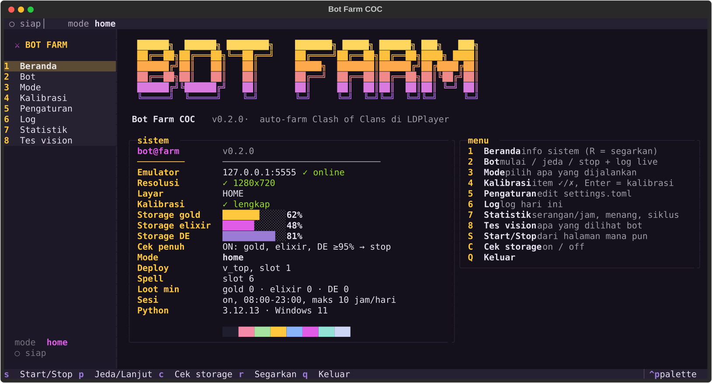
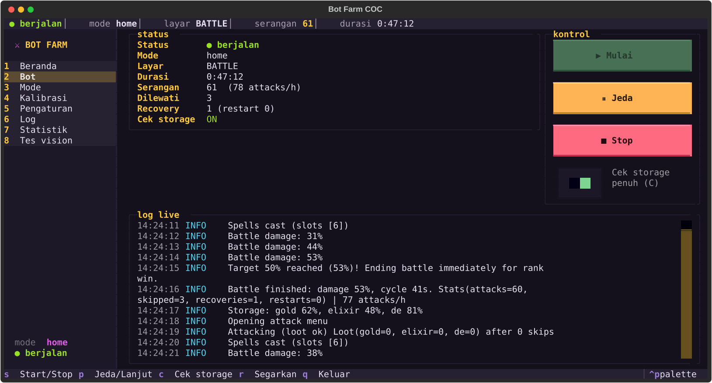
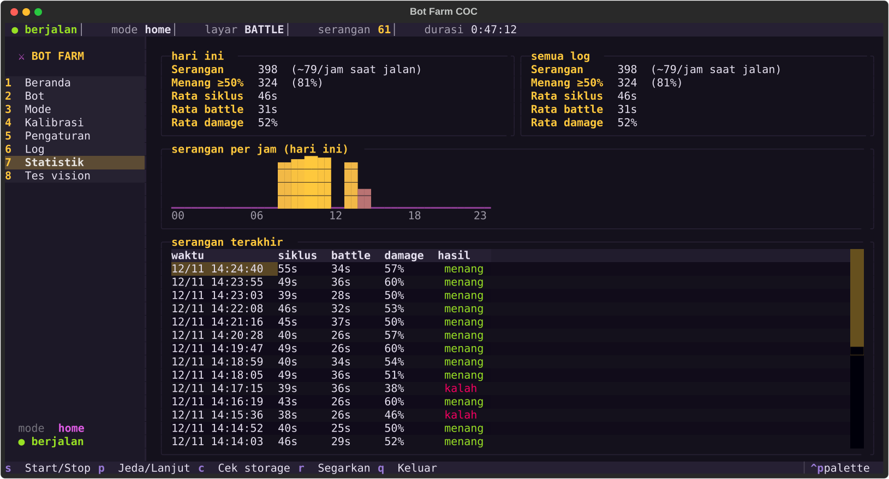

<p align="center">
  
</p>

<p align="center">
  
  
  
  
  
  
</p>

<p align="center">
  A screen-reading farming bot for Clash of Clans in an Android emulator, driven from a terminal dashboard.<br>
  ADB screenshots in, taps out — no memory reading, no packet tampering, no modified game files.
</p>

> [!WARNING]
> Automating gameplay violates Supercell's [Terms of Service](https://supercell.com/en/terms-of-service/)
> and can get an account **permanently banned**. Use a spare account. Not affiliated with Supercell.

<p align="center">
  
</p>

## Features

- **Fast win farming** — attacks, stops at **50 %** for the win and league bonus, then starts the next battle.
- **Army** — troops in rows along the battlefield edge, siege machine, heroes with abilities, spells (e.g. Rage)
  in rows just in front of the troops.
- **Loot filter** *(optional)* — OCR on the enemy's loot, skips weak bases; off = no loot OCR at all.
- **Storage-full check** — reads your resource bars and stops or waits when everything is full.
- **Self-recovery** — popups, stuck screens and lost ADB connections: *Back* → game restart → safe stop.
- **Human-like** — tap jitter, random delays, optional play / break sessions with a daily cap.
- **Builder Base** — `elixir` mode (drop one troop, surrender, collect the Elixir Cart every N attacks) or
  `gold` mode (hero + Giant + Night Witch at one point, stage 2 included).
- **Terminal dashboard** — start, pause, stop, calibrate, edit settings, read logs and stats in one place.

## Dashboard

```powershell
.venv\Scripts\python -m coc_bot
```

| | |
|:---:|:---:|
|  |  |
| **Bot** — live status, controls, log | **Statistik** — wins, cycle time, attacks per hour |

| Key | Page | |
|:---:|---|---|
| `1` | Beranda | Emulator, resolution, calibration, storage levels, active settings |
| `2` | Bot | Start / pause / stop, storage-check switch, live status and log |
| `3` | Mode | What runs on start: `home`, `builder elixir`, `builder gold` (`walls`, `auto` planned) |
| `4` | Kalibrasi | Items your settings use, ✓ / ✗ — **Enter** to calibrate, **A** to show all |
| `5` | Pengaturan | Edit `settings.toml`, validated on **Ctrl+S** |
| `6` | Log | Today's log, coloured by level |
| `7` | Statistik | Per-attack history from `logs/attacks-*.csv` |
| `8` | Tes vision | What the bot sees right now: screen, template scores, bars, OCR |

Anywhere: `S` start / stop · `P` pause · `C` storage check on / off · `R` refresh · `Q` quit.
Use a terminal at least 120 columns wide (Windows Terminal).

## Quick start

**1. Install** (Windows, Python 3.12)

```powershell
git clone https://github.com/ZulhanF/bot-farm-coc.git
cd bot-farm-coc
py -3.12 -m venv .venv
.venv\Scripts\python -m pip install -r requirements.txt
copy settings.example.toml settings.toml
```

**2. Emulator** — LDPlayer 9 at **1280 × 720, 240 DPI**, *ADB debugging: open local connection*.
Open the game and zoom fully out. If ADB is not found, set `[adb] adb_path` in `settings.toml`.

**3. Calibrate** — open the dashboard, page `4`, select each ✗ item and press **Enter**: drag a box on the
screenshot, **Enter** to save, **C** to cancel.

| Kind | Items |
|---|---|
| Buttons | `home_attack`, `btn_find_match`, `btn_attack`, `btn_next`, `btn_end_battle`, `btn_return_home`, `popup_okay` |
| Storage bars | `home_gold_bar`, `home_elixir_bar`, `home_de_bar` — the coloured fill, without the icon |
| Deploy | `map_11`, `map_9`, `map_1`, `map_3` (battlefield edges), `troop_slot_N` (each card) |
| Spells | `map_center` (middle of the enemy base) |
| Loot filter | `gold`, `elixir`, `de` — only the digits on the enemy preview |

Check the result on page `8`. Pick the static part of a button, not its glow.

**4. Run** — page `2`, **Start** (or `S`).

### Builder Base (desa malam)

Pick `builder elixir` or `builder gold` on page `3` (or `run --mode builder --builder-mode gold`). Page `4`
then lists the Builder Base items; `check --mode builder` prints them too.

| Kind | Items |
|---|---|
| Buttons | `bb_boat` (home village), `bb_attack`, `bb_btn_find_now`, `bb_btn_surrender`, `bb_btn_return_home`, `bb_elixir_cart`, `bb_btn_collect` |
| Screens | `bb_prep` (stage-1 "battle starts" banner), `bb_stage2_prep` (gold) |
| Deploy | `bb_deploy_stage1`, `bb_deploy_stage2` (gold), `bb_slot_N` (each card you use) |
| OCR | `bb_damage` (gold), `bb_result_gold` (optional) |

- **elixir** — Builder Elixir comes from the defense every search opens, so the bot surrenders at once and
  collects the Elixir Cart every `cart_every` attacks. Surrendering wins no trophies, so **your Builder
  trophies (and the elixir per defense) drop over time**.
- **gold** — choose Battle Copter in the Builder Base army; Giant on `tank_slot`, Night Witches on
  `main_slots`. Stage 2 is attacked when it appears (`stage2 = false` ends the battle instead).

## Configuration

`settings.toml` — edit on page `5` or in any editor. Full reference: [`settings.example.toml`](settings.example.toml).

| Section | Main keys |
|---|---|
| `[loot]` | `min_gold`, `min_elixir`, `min_de`, `max_next` — all `0` attacks the first base |
| `[deploy]` | `pattern`, `points_per_side`, `taps_per_point`, `troop_slots`, `siege_slot`, `hero_slots` |
| `[spells]` | `slots`, `casts`, `delay_s`, `depth` (`0` on the troop line … `1` at `map_center`) |
| `[storage]` | `full_ratio`, `on_full` (`"stop"` / `"wait"`), `wait_minutes` |
| `[timing]` | `battle_timeout_s`, `damage_stagnant_s`, `tap_delay_ms`, `progress_timeout_s` |
| `[session]` | `enabled`, `play_minutes`, `break_minutes`, `active_hours`, `max_hours_per_day` |
| `[builder]` | `mode` (`"elixir"` / `"gold"`), `cart_every`, `troop_slot`, `hero_slot`, `tank_slot`, `main_slots`, `stage2` |

> [!IMPORTANT]
> Running 24/7 with `session.enabled = false` is the easiest pattern for anti-bot systems to spot.

## Command line

| Command | |
|---|---|
| `python -m coc_bot` | Dashboard |
| `python -m coc_bot run [--mode home\|builder] [--builder-mode elixir\|gold]` | Run without the dashboard (**Ctrl+C** stops) |
| `python -m coc_bot check [--mode builder]` | Missing calibration items |
| `python -m coc_bot calibrate <template\|roi\|point> <name>` | Calibrate one item |
| `python -m coc_bot screenshot` · `test-vision <image>` | Save / analyse a screenshot |

Logs: `logs/bot-YYYY-MM-DD.log`, per-attack `logs/attacks-YYYY-MM-DD.csv` (Builder Base:
`logs/builder-YYYY-MM-DD.csv`), and `logs/screens/` on recovery.
Tests run without an emulator: `.venv\Scripts\python -m pytest -q`.

## Troubleshooting

| Symptom | Fix |
|---|---|
| `resolution must be 1280x720` | Set LDPlayer to 1280 × 720, 240 DPI, restart it. |
| ADB timeout / emulator closes | Low RAM: give LDPlayer 3–4 GB, FPS 30, close other heavy apps. |
| A button is never found | Recalibrate it; its score on page `8` should be ≥ 0.85. |
| Wrong loot numbers | Recalibrate `gold` / `elixir` tightly around the digits. |
| Stops with `Storage full` | Expected. Spend resources, set `on_full = "wait"`, or press `C` to test anyway. |

## License

[MIT](LICENSE) © 2026 Zulhan Fadhil

<p align="center">
  <sub>"Clash of Clans" is a trademark of Supercell Oy; this project is not affiliated with Supercell.<br>
  Banner artwork is original. Title font <a href="https://fonts.google.com/specimen/Lilita+One">Lilita One</a>
  by Juan Montoreano, <a href="https://openfontlicense.org">SIL Open Font License 1.1</a>.</sub>
</p>
